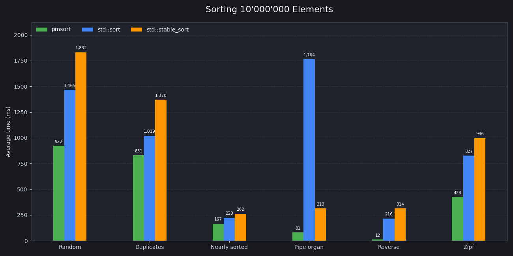

# Pmsort
<br>
pmsort (partition merge sort) is an adaptive, stable sorting algorithm by using the multi-way distribution partitioning to achieve higher performance on modern CPUs. Codes are available for free under MIT license. 

```
Best | Average    | Worst      | Deterministics | Stable
O(n) | O(n log n) | O(n log n) | Yes            | Yes
```
```
Memory: O(n)
```

# Usage

### Require: C++17+

### Using:
```cpp
pmsort(first, last, comparator);
pmsort(container, comparator);
```

`pmsort` is a drop-in replacement for [`std::stable_sort()`](https://en.cppreference.com/cpp/algorithm/stable_sort). Just include the header and call ```pmsort()``` to start using partition merge sort.

# Visualization
This visualization below shows how `pmsort` sorting 256 random elements 


# Benchmark
 OS: `Ubuntu 24.04.5 LTS x86_64`<br>
 Compiler: `g++` <br>
 Compiler flags: `-O3 -march=native -std=c++20`

 
 

 **Results(10 runs, N=10'000'000):**
 
| Case | pmsort | std::sort | std::stable_sort |
| :--- | :---: | :---: | :---: |
| Random | **922ms** | 1465ms | 1832ms |
| Duplicate | **831ms** | 1019ms | 1370ms |
| Nearly Sorted | **167ms** | 223ms | 262ms |
| Pipe Organ | **81ms** | 1764ms | 313ms |
| Reversed | **12ms** | 216ms | 314ms |
| Zipf | **424ms** | 827ms | 996ms |

*This does not mean `pmsort` always faster than [`std::sort`](https://en.cppreference.com/cpp/algorithm/sort), there are many implementations across different compilers*

# Algorithm
## The best cases
Before sorting, `pmsort` scans linearly through the array to check if it is sorted or strictly descending, in order to return or reverse the array. It also scans for natural runs; if the array contains only a few runs, it bypasses partitioning and merges them directly

## Partitioning
**`pmsort`** employs a dynamic multi-way partitioning strategy where the number of partitions scales with the current data range (as a power of 2, up to 256 partitions per layer). It uses a deterministic [Weyl sequence](https://en.wikipedia.org/wiki/Weyl_sequence) for stratified sampling, sorts the samples, filters out duplicate values to establish unique splitters (padded to a power of 2), and organizes them into a [Eytzinger layout](https://algorithmica.org/en/eytzinger).
For any value, `pmsort` traverses the Eytzinger tree from the root down to a leaf by comparing the element against node splitters at each level. Reaching a leaf maps the element to a precise partition ID—distinguishing between open value intervals (even IDs) and exact-match equivalence classes (odd IDs) that require no further division. After it, `pmsort` finds offset for each partitions and scatters all the elements to right partition from left to right. For even IDs, algorithm continues recursive partitioning until the size reaches the leaf level or the maximum recursive depth is reached.

## Merge
